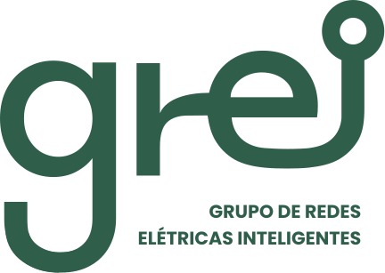

# ARGOS

Interface para inspeção de resultados de co-simulação de redes elétricas, qualidade da energia e comunicação, desenvolvida no contexto do OpenTES pelo time de Qualidade de Energia (TSDQ) do Grupo de Redes Elétricas Inteligentes (GREI), da Universidade Federal do Ceará.




A ARGOS relaciona a topologia da rede às medições fornecidas pelos simuladores. O usuário pode consultar barramentos, ramos e equipamentos, selecionar instantes e examinar séries temporais, tabelas e indicadores. A interface não orquestra a co-simulação externa; no modo OpenDSS, compila o circuito enviado para construir sua representação topológica.

## Funcionalidades

| Módulo | Entrada | Recursos disponíveis |
| --- | --- | --- |
| **Mapa de Rede** | Topologia JSON e resultados CSV vinculados por SHA-256, ou circuito OpenDSS em ZIP | Grafo em D3/JavaScript ou Agraph, seleção de barramentos e equipamentos, inspetor e diagnósticos. A análise elétrica contextual utiliza as medições do CSV ou dos monitores OpenDSS compatíveis; a reprodução de tensão no D3 e os cartões QEE dependem das variáveis disponíveis. |
| **Análise Elétrica** | CSV ou tabela H5/HDF5 compatível | Seleção por tipo, elemento e variável; gráficos individuais e multissérie; distribuição das tensões; tabelas e cartões QEE quando há magnitude de tensão reconhecida. Não exige JSON. |
| **Comunicação** | CSV no formato `Tempo`, `Origem`, `Atributo`, `Valor`, com dados em `val_out` para a origem escolhida | Seleção de origem e, após a expansão das mensagens, contadores de pacotes, taxa de descarte, latência, jitter, gráficos e tabelas. |

Os cartões de DRP e DRC apresentam os resultados por fase e separam as contribuições de subtensão e sobretensão. No Mapa de Rede, o vínculo com a topologia preserva a identificação dos barramentos, ramos e equipamentos associados. Na Análise Elétrica independente, a identificação se baseia nos cabeçalhos e no mapeamento, sem conferir a conexão física dos elementos.

## Tecnologias

- **Python e Streamlit:** aplicação multipágina, controles e estado de sessão.
- **pandas, NumPy e PyTables:** leitura e tratamento tabular, operações numéricas e tabelas HDF5.
- **Plotly:** gráficos temporais, distribuições e visualizações de comunicação.
- **D3/JavaScript e streamlit-agraph:** alternativas de renderização do grafo.
- **OpenDSSDirect.py:** acesso ao circuito OpenDSS no modo ZIP.

As dependências declaradas estão em [pyproject.toml](pyproject.toml), e suas resoluções estão registradas em [uv.lock](uv.lock). Os exemplos de execução abaixo utilizam o gerenciador `uv`.

## Instalação e execução

### Pré-requisitos

- Git, para clonar o repositório.
- `uv` instalado e disponível no terminal. Consulte a [documentação de instalação do uv](https://docs.astral.sh/uv/getting-started/installation/).
- Python compatível com o projeto. O [pyproject.toml](pyproject.toml) exige Python >= 3.12, e [.python-version](.python-version) indica **3.12.11** para o ambiente de referência. Essa versão deve estar disponível ou poder ser obtida pelo `uv`.
- Navegador para acessar a aplicação.
- Acesso à internet para obter dependências e para carregar a biblioteca D3 usada pelo componente JavaScript.

A declaração `Python >= 3.12` é um requisito do projeto, não uma comprovação de compatibilidade com todos os interpretadores posteriores. As verificações locais desta documentação utilizaram Python 3.12.11 no WSL; não equivalem a uma instalação limpa validada em todos os sistemas operacionais.

VS Code é uma opção de editor, não um requisito da aplicação. Se já houver Python com `pip` disponível, uma das formas de instalar o `uv` é:

```bash
python -m pip install uv
uv --version
```

No Linux/WSL, o executável dessa instalação pode se chamar `python3` em vez de `python`. Depois de instalado o `uv`, os comandos do projeto utilizam `uv run python`.

### Obter o código

O exemplo abaixo utiliza a branch `ARGOS` do fork que contém a implementação descrita neste documento:

```bash
git clone --branch ARGOS https://github.com/betomsales/tsdq-dataview-opentes.git
cd tsdq-dataview-opentes
```

O [repositório institucional](https://github.com/grei-ufc/tsdq-dataview-opentes) permanece como referência do projeto. Ao utilizar outro repositório ou branch, ajuste a clonagem para o destino que contenha a implementação desejada. Se já possui o checkout da ARGOS, não é necessário cloná-lo novamente.

### Preparar o ambiente e iniciar

Execute na raiz do repositório, onde se encontram `Home.py` e `pyproject.toml`:

```bash
uv sync --locked
uv run python -m streamlit run Home.py
```

O primeiro comando prepara o ambiente `.venv` conforme o arquivo de dependências bloqueadas. O segundo inicia a interface. Abra o endereço informado pelo Streamlit no terminal; na configuração padrão, ele é `http://localhost:8501`. Para encerrar, pressione **Ctrl+C** no terminal do servidor.

`Home.py` deve ser executado pelo Streamlit, não como um script Python isolado. O projeto não declara um comando de inicialização chamado `tsdq`.

No WSL, execute a instalação e a aplicação no próprio ambiente Linux. Use caminhos como `/mnt/c/...` e barras `/` nos comandos; coloque caminhos com espaços entre aspas. Ambientes `.venv` de Windows e Linux não são intercambiáveis.

### Configuração

Não há variáveis de ambiente obrigatórias definidas pela aplicação para a execução local. Os principais arquivos de configuração são:

| Arquivo | Responsabilidade |
| --- | --- |
| [.streamlit/config.toml](.streamlit/config.toml) | Tema visual do Streamlit. |
| [configs/mapeamento.json](configs/mapeamento.json) | Regras de reconhecimento das colunas, tipos, fases e metadados usados na análise elétrica. |
| [configs/rotulos_medicoes.json](configs/rotulos_medicoes.json) | Rótulos e unidades configuradas para variáveis de medição. |

As opções do servidor podem ser passadas na inicialização, sem editar o código. Por exemplo, para utilizar outra porta:

```bash
uv run python -m streamlit run Home.py --server.port=8502
```

## Utilização e formatos de entrada

Carregue somente arquivos de origem confiável, especialmente circuitos ZIP e tabelas HDF5. Cada módulo possui um fluxo de leitura próprio; aceitar uma extensão não significa aceitar qualquer organização interna de dados.

### Mapa de Rede: JSON + CSV

1. Abra **Mapa de Rede** e selecione **Resultados da co-simulação**.
2. Envie a topologia `.json` e o arquivo temporal `.csv` correspondente.
3. Aguarde a conferência do vínculo SHA-256. Sem um hash registrado e correspondente ao CSV, o carregamento integrado é bloqueado.
4. Escolha o instante e o renderizador do grafo. No D3, é possível selecionar e arrastar os nós; a reprodução temporal depende das colunas de tensão em pu descritas abaixo.
5. Selecione o barramento no grafo ou no controle **Barramento analisado**. No D3, **Analisar nó** comunica a seleção e o instante às análises da página.
6. Consulte as abas **Inspetor**, **Análise Temporal** e **Dados de Qualidade Energética**. O seletor **Elemento de linha**, ao final da página, inclui os ramos com medições numéricas disponíveis no instante selecionado, não necessariamente todos os ramos medidos em algum ponto do arquivo.

A reprodução do D3 ocorre no navegador e percorre as linhas do CSV em intervalos fixos de 650 ms, reiniciando ao fim; não reproduz a duração real entre timestamps. Os quadros locais contêm tensões por fase, e não a evolução de todas as grandezas dos equipamentos. Para construir esses quadros, o leitor reconhece variáveis de barramento `V1_pu`, `V2_pu`, `V3_pu` e seus equivalentes `VA_pu`, `VB_pu`, `VC_pu`. Sem essas séries reconhecidas, não há quadros temporais no D3. Tensões em V ou kV não são automaticamente convertidas para colorir o grafo.

O inspetor reflete o instante comunicado pelo componente ou selecionado no controle da página. Já os gráficos de séries e os cartões QEE utilizam o período do arquivo carregado: mudar o instante posiciona a consulta e o marcador, mas não recorta o período de apuração de DRP/DRC. Não há uma execução Python a cada quadro da animação.

**Topologia JSON.** O arquivo descreve os barramentos, as conexões e os equipamentos da rede. A estrutura de referência utiliza:

| Campo | Conteúdo |
| --- | --- |
| `version` | Inteiro `2`, que seleciona o leitor para a estrutura de campos desta tabela. |
| `nodes` | Barramentos com `name`, `kv_base`, `nodes`, `x` e `y`. |
| `edges` | Ramos com `type`, `name`, `source`, `target`, `phases`, `open` e `regcontrols`. |
| `elements` | Equipamentos com `type`, `name`, `bus`, `nodes` e `phases`. |
| `results_sha256` | Hash SHA-256 do CSV associado, armazenado no primeiro nível do JSON. |

O campo `version` é um discriminador técnico, não o nome do formato. Para a estrutura da tabela, mantenha `"version": 2` como inteiro. O código também aceita o inteiro `1` ou a ausência do campo por um caminho de compatibilidade, que não aplica as mesmas regras de cadastro e classificação; outros valores ou tipos são rejeitados. Remover ou trocar o discriminador não converte a estrutura. O contrato detalhado está em [docs/entrada_topologia.md](docs/entrada_topologia.md) e a seleção do leitor em [topology_adapter.py](modules/network/topology_adapter.py).

Na estrutura da tabela, os três vetores `nodes`, `edges` e `elements` e as chaves listadas em cada registro são obrigatórios. Deve existir ao menos um barramento; `edges` e `elements` podem ser listas vazias. `kv_base` admite número finito não negativo ou `null`, e `x`/`y` admitem números finitos ou `null`; coordenadas zero são válidas. As listas de nós conectados contêm inteiros não negativos sem repetição, e `phases` é um inteiro positivo, não necessariamente igual ao comprimento de `nodes`.

O estado `open` deve ser um booleano JSON (`true` ou `false`). `regcontrols` é uma lista de objetos com `name` e `bus`; controles não vazios só são aceitos em ramos `Transformer`. A identidade do barramento é seu nome, e a de ramos e equipamentos é composta por tipo e nome, com comparação normalizada. Duplicidades de identidade e referências a barramentos inexistentes são rejeitadas.

No cadastro de equipamentos, são reconhecidos `Vsource`, `Load`, `Capacitor`, `PVSystem`, `Storage` e `Generator`; nos ramos, `Line`, `Switch` e `Transformer`. A classificação visual dos barramentos decorre dos equipamentos e controles declarados, conservando as diferentes características de uma mesma barra. O campo `open` descreve um estado topológico, não uma sequência temporal de manobras.

**Resultados CSV.** O leitor do mapa utiliza `pandas.read_csv` com os padrões de separação por vírgulas e codificação UTF-8. O JSON é decodificado como UTF-8, admitindo BOM. A primeira coluna do CSV é interpretada como tempo por `pandas.to_datetime`, e as seguintes compõem o catálogo de medições. Forneça ao menos duas amostras para o controle temporal da página: com uma única linha, o intervalo do slider tem extremos iguais e provoca erro.

Forneça datas/horas textuais interpretáveis, por exemplo em ISO 8601: números de tempo relativo não são automaticamente tratados como segundos e podem ser interpretados como timestamps em nanossegundos. Valores temporais inválidos tornam-se NaT; não há, nesse carregador, uma validação de ordem cronológica, cadência regular ou cobertura completa do período.

Os cabeçalhos devem seguir as convenções reconhecidas, por exemplo:

| Cabeçalho ilustrativo | Interpretação |
| --- | --- |
| `DSS-0.Bus-634-V1_pu` | Tensão da fase 1 do barramento 634, em pu. |
| `DSS-0.Line-650632-I1_A` | Corrente da fase 1 da linha 650632, em A. |
| `DSS-0.PVSystem-pv1-P_meas` | Potência ativa medida do equipamento `pv1`. |
| `DSS-0.PVSystem-pv1-Q_meas` | Potência reativa medida do equipamento `pv1`. |

O número da instância DSS não é fixado em zero. Na estrutura JSON descrita na tabela, as colunas `DSS-*.PVSystem-...` são vinculadas pelo nome do equipamento e por sua conexão no JSON, não pela suposição de que o identificador contenha o número da barra. Referências desconhecidas, ambíguas ou conflitantes permanecem sem associação e podem ser consultadas em **Medições não associadas**.

Essa resolução não cria automaticamente uma relação entre `PVSystem-pv1`, `PVPanel_0` e `Inverter_0`. Colunas de `PVSimulator` e `InverterSim` têm regras próprias; uma referência explícita como `PVPanel_0_bus634-temperature` pode informar a barra, mas o cadastro de um PVSystem, sozinho, não mapeia esses identificadores. O caminho de compatibilidade ainda admite uma associação por barramento PV único quando não existe cadastro explícito; isso não deve ser tomado como prova da origem física das medições. As condições estão em [measurement_binding.py](modules/network/measurement_binding.py) e [pv_binding.py](modules/network/pv_binding.py).

**Vínculo SHA-256.** A interface calcula o hash dos bytes originais do CSV e o compara com o texto encontrado no JSON, removendo espaços externos e ignorando a caixa do resumo hexadecimal. A busca percorre, nesta ordem, `metadata`, `metadata.hash`, a raiz e `hash` na raiz; em cada objeto, procura `results_sha256`, `csv_sha256` e `sha256`, utilizando o primeiro texto não vazio. Não há comparação de consistência entre todos os campos: um alias antigo em `metadata` pode prevalecer sobre um hash correto na raiz. Evite declarações conflitantes.

A interface não gera nem substitui o vínculo durante o upload. O hash confere a identidade do arquivo declarado, mas não autentica sua autoria nem comprova que a topologia, as unidades ou o cenário físico estejam corretos. Alterar ou recortar o CSV exige um vínculo correspondente ao novo conteúdo. A regra de leitura e comparação está em [utils/vinculo_arquivos.py](utils/vinculo_arquivos.py).

### Mapa de Rede: circuito OpenDSS em ZIP

Selecione **Circuito OpenDSS (.zip)** e envie o circuito com seus arquivos `.dss` e demais dependências referenciadas. O carregador extrai os arquivos em uma pasta temporária e procura o arquivo principal, priorizando nomes que contenham `master`, `main` ou `run`; dentro de cada grupo, escolhe o nome mais curto. Sem esses nomes, utiliza o único DSS ou o maior arquivo disponível. A escolha é heurística, sem confirmação de que aquele é o circuito pretendido.

Os arquivos DSS são lidos como Latin-1, com extensões `.dss` ou `.DSS`. O ajuste de capitalização dos `Redirect` não constitui uma resolução geral de todos os caminhos ou comandos do circuito.

A compilação utiliza uma cópia do arquivo principal sem comandos `Show` e `Plot`, em contexto isolado do OpenDSS. Os comandos de simulação presentes no circuito são executados; a interface não acrescenta um `Solve` nem define uma duração de simulação. Os resultados são lidos da API de monitores dessa execução, não dos CSVs previamente exportados e incluídos no ZIP. Sem amostras compatíveis, o grafo permanece disponível, sem histórico inventado.

São integrados os modos de monitor `0` (tensão/corrente) e `1` (potência). Pares retangulares de tensão/corrente são convertidos em magnitude e ângulo; potência polar em kVA/ângulo é convertida em P/Q. A tensão é convertida de V para pu apenas quando há base válida na barra; caso contrário, permanece em V. Potências usam kW/kvar e correntes usam A. Para PVs, P/Q são normalizados para sinal positivo de injeção; os canais brutos conservam o sinal original do OpenDSS.

O terminal e o elemento monitorados determinam as associações. Tensões pertencem à barra do terminal; correntes e potências permanecem no ramo ou equipamento monitorado. O controle **Terminais dos ramos** evita misturar medições de terminais diferentes nos mesmos cálculos; o padrão é o menor terminal disponível. Condutores neutros não são tratados como fases, e zero continua sendo uma medição válida. Não se deduz cobertura de todas as fases apenas pela existência da barra.

O tempo é expresso em horas decorridas (`dblHour`), sem data fictícia. Eixos ausentes, repetidos ou não crescentes não são integrados. Séries com horários distintos são alinhadas sem interpolação ou preenchimento de lacunas. Havendo mais de um monitor para a mesma tensão/fase, o primeiro é usado nas análises; divergências são avisadas, sem média entre fontes. Ramos com associação ambígua, como transformadores com mais de dois terminais, não recebem automaticamente correntes/potências.

Os monitores, as limitações de leitura e os canais brutos com eixo temporal válido ficam em **Monitores e dados OpenDSS**. Outros modos permanecem nessa tabela quando possível, mas não alimentam os cálculos elétricos. Os indicadores descrevem o período e as amostras disponíveis; carregar um circuito diário não certifica uma campanha regulamentar de medição.

Os resultados são reutilizados pelo cache de dados do Streamlit, limitado a três entradas, sem compartilhar um motor OpenDSS ativo. Cada leitura utiliza diretório temporário removido ao final; caminhos de extração fora dessa pasta são rejeitados. Isso não constitui um ambiente de segurança para os comandos DSS: utilize circuitos confiáveis. O adaptador está em [dss_results.py](modules/network/dss_results.py) e os controles exclusivos desse modo em [entrada_zip.py](components/entrada_zip.py). O vínculo por hash da entrada JSON + CSV não é alterado por esse fluxo.

### Análise Elétrica: CSV ou HDF5

Abra **Análise Elétrica** e envie um `.csv`, `.h5` ou `.hdf5`. A leitura independente de CSV tenta UTF-8 e, em caso de erro de decodificação, Latin-1; esse fallback não existe no leitor CSV do mapa. A primeira coluna do DataFrame resultante é utilizada como referência temporal; se nenhum valor puder ser interpretado como tempo, a posição das amostras é usada no eixo. Valores parcialmente inválidos permanecem NaT.

Os cabeçalhos são reconhecidos pelas regras de [configs/mapeamento.json](configs/mapeamento.json). Esse caminho utiliza `mapear_colunas` e `organizar_variaveis`, não o resolvedor topológico do mapa: um cabeçalho aceito no mapa não tem garantia de produzir o mesmo tipo ou rótulo nesta página. Sem colunas reconhecidas, a página interrompe a análise.

Na análise temporal, selecione tipo, elemento e variável para consultar gráficos e tabelas. Na aba **Dados de Qualidade Energética**, o seletor **Tensão de referência** restringe as tensões usadas na apuração, mas não filtra automaticamente todos os outros cartões pelo elemento escolhido na aba temporal. Correntes, potências e outras grandezas podem vir de diferentes elementos do arquivo. Não interprete esse conjunto como uma análise topológica exclusiva de uma barra. Esse fluxo é independente da topologia JSON e da verificação de hash do mapa.

O suporte a HDF5 espera uma estrutura que produza um DataFrame compatível com pandas/PyTables. A interface não oferece seleção de chave: o leitor utiliza a primeira retornada por `HDFStore.keys()`, não necessariamente a tabela pretendida pelo usuário. Índices diferentes de `RangeIndex` são convertidos em colunas antes da interpretação temporal, podendo mudar qual coluna é a primeira. Existe um fallback por `h5py` para `ImportError`, não para qualquer falha de leitura; `h5py` não consta das dependências declaradas em `pyproject.toml`. Não se trata de um leitor genérico de qualquer estrutura HDF5, e esse formato não é uma entrada do Mapa de Rede.

### Comunicação: CSV de registros

O leitor utiliza CSV separado por vírgulas e UTF-8. Ele verifica a existência das colunas `Tempo`, `Origem`, `Atributo` e `Valor`, mas não valida completamente seus tipos, unidades ou conteúdo. Após essa conferência, selecione a origem. Utilize identificadores textuais em `Origem`: o seletor converte os nomes em texto, mas o filtro compara com os valores originais, podendo não encontrar origens lidas como números. Os atributos são pivotados por tempo; havendo mais de um valor para o mesmo tempo e atributo, utiliza-se o primeiro, não uma soma.

Para abrir o painel, a origem escolhida também precisa ter conteúdo não vazio em `val_out` que produza mensagens expandidas. Se isso não ocorrer, a página mostra um aviso e a tabela temporal disponível, mas interrompe a execução antes dos cartões e gráficos, mesmo que existam contadores de pacotes.

Os atributos `packets_sent`, `packets_received` e `packets_dropped` alimentam os indicadores; cada contador exibido é o máximo encontrado na série da origem, não a soma nem necessariamente o último valor. A taxa de descarte utiliza esses máximos, e os pacotes em trânsito são calculados por `max(0, enviados - recebidos - descartados)`. Reinícios de contadores ou registros incrementais exigem cuidado na interpretação.

As listas de `val_out`, `packet_sizes_out`, `latencies_out` e `jitters_out` são separadas por `|||`. Para extrair o remetente, o leitor espera mensagens JSON em forma de objeto, com `sender` textual quando presente. A ausência de remetente e alguns erros tratados recebem o rótulo `Rede`, mas não há validação completa do protocolo FIPA-ACL nem tratamento de toda estrutura JSON possível; por exemplo, uma lista JSON pode provocar erro. Contadores ausentes ou não numéricos e itens de tamanho, latência ou jitter ausentes ou não convertíveis podem ser preenchidos com zero. Portanto, zero exibido não comprova uma medição nula real.

Latência e jitter são rotulados como segundos, e tamanho de pacote como bytes, sem detecção ou conversão de unidades pelo leitor. Os resultados são obtidos dos registros enviados, não inferidos das medições elétricas. Essas regras estão em [utils/comunicacao.py](utils/comunicacao.py) e a condição de abertura do painel em [pages/2_Comunicação.py](pages/2_Comunicação.py).

## Interpretação das grandezas

A rotina de cartões QEE exige ao menos uma magnitude de tensão reconhecida em pu, V ou kV no elemento de referência. Sem ela, retorna antes de apresentar os demais cartões, mesmo que existam colunas de corrente ou potência. No mapa, o inspetor usa o instante selecionado, enquanto os cartões de médias e indicadores usam as séries do período carregado.

- **Barramentos:** tensões e ângulos de tensão. **Ramos:** suas medições de corrente e fluxo. **Equipamentos:** suas próprias medições, conservando a identidade mesmo quando consultadas pela barra de conexão.
- **Fases:** para as fases reconhecidas, a ausência é identificada pelos nós conectados declarados na topologia ou por uma série inteiramente NaN. Essa identificação é usada na apuração de DRP/DRC e na preparação das tensões do grafo, sem remover as colunas do DataFrame original nem garantir sua omissão em todo cartão ou gráfico. Uma fase declarada como não conectada pode ser excluída da apuração mesmo que o CSV apresente valores nela. Um NaN pontual não elimina uma fase com medições em outros instantes. Quando a fase é considerada presente, zero participa da apuração, inclusive quando persiste em toda a série.
- **Cobertura visual das fases:** no D3, os setores coloridos representam medições em pu, cinza sólido representa fase ausente e hachuras representam falta de medição em pu. Quando a topologia declara as fases presentes, ela determina a configuração visual da barra; uma barra trifásica com monitor monofásico não é apresentada como monofásica. Sem declaração topológica, o resumo informa que a configuração não foi fornecida e identifica separadamente ausências inferidas da série NaN. Essa distinção é de apresentação: não altera as regras de cálculo de QEE descritas acima. Agraph e inspetor também informam a configuração e o estado de cada fase em seus textos.
- **DRP e DRC:** calculados por fase sobre as amostras numéricas válidas, com contribuições de subtensão e sobretensão. NaN, valores não numéricos e infinitos não entram no denominador. Os cartões destacam a fase de maior total para cada indicador. O cálculo utiliza contagens, sem ponderar a duração entre registros; tensões absolutas exigem uma referência positiva por coluna, na mesma unidade da série. Os cartões utilizam os limites padrão de `obter_limites_prodist()`, não as edições de limites realizadas nos controles dos gráficos.
- **Rótulos e médias dos cartões:** a função `montar_card_fases` calcula médias por coluna e as armazena por rótulo. Se mais de uma coluna produzir a mesma chave, a última substitui a anterior; não há uma agregação garantida de todos os equipamentos ou de todas as medições daquela fase. Os cartões DRP/DRC também usam o rótulo de fase como chave, podendo sobrepor resultados quando ele se repete; a tabela detalhada mantém a identificação das colunas apuradas.
- **Potência aparente:** a análise de grandezas derivadas aplica `S = sqrt(P² + Q²)` aos valores numéricos das colunas do mesmo elemento que tenham fases P/Q correspondentes. Colunas totais `P_meas`/`Q_meas`, sem identificação de fase, não bastam para essa rotina. Ela não valida nem compatibiliza as unidades antes do cálculo; por exemplo, misturar P em W e Q em kvar produz um resultado sem interpretação dimensional correta. Havendo múltiplas colunas para uma mesma chave de fase P ou Q, a última encontrada é utilizada. O gráfico não calcula automaticamente um total trifásico nem declara a unidade de S.
- **Fotovoltaicos:** a presença de `PVSystem` é topológica. Para o estado de geração, a seleção prioriza as categorias de potência ativa de PVSystem, inversor AC e painel DC, nessa ordem. A implementação rotula `P_meas` positivo, acima da tolerância interna, como injeção e negativo como absorção; não detecta automaticamente a convenção de sinais do exportador. Confirme essa convenção antes de interpretar o estado exibido. O cadastro não cria dados de temperatura, irradiância, potência DC ou de inversor ausentes no CSV.

No leitor de medições do mapa, um sufixo de unidade reconhecido tem prioridade sobre a unidade configurada. Na ausência desse sufixo, `P_meas` e `Q_meas` recebem provisoriamente W e var, e `irradiance` recebe kW/m². A atribuição desses rótulos não converte valores exportados em outra unidade. Escalas de apresentação também podem mudar o rótulo visual; confirme a unidade original com o exportador. `kv_base` é preservado em kV, sem conversão automática entre tensões fase-neutro, fase-fase e pu.

As regras de apuração estão em [utils/qee.py](utils/qee.py); a seleção e composição dos cartões, em [components/cards_qee.py](components/cards_qee.py); e o cálculo de potência aparente, em [components/analise_eletrica_rede.py](components/analise_eletrica_rede.py).

## Scripts auxiliares

Os scripts são independentes da interface. Os caminhos abaixo são exemplos: substitua-os por arquivos existentes da sua simulação.

### Registrar o hash do CSV no JSON

Utilize somente um par cuja correspondência com o mesmo cenário já tenha sido conferida:

```bash
uv run python scripts/aplicar_hash_topologia.py --csv "dados/resultados.csv" --json "dados/topologia.json"
```

Sem opções de destino, a saída utiliza o sufixo `_com_hash.json`, sem alterar o JSON de entrada. `--saida` define o destino e `--sobrescrever` utiliza o próprio JSON de entrada; essas opções não podem ser usadas juntas. **O script abre o destino para escrita e pode sobrescrever um arquivo existente sem confirmação.** Inclusive `--saida` apontando para o JSON original o sobrescreve, mesmo sem `--sobrescrever`. Escolha destinos distintos ou faça uma cópia de segurança.

O script exige um objeto JSON na raiz, mas não valida a estrutura topológica, suas referências ou a correspondência física entre os arquivos. Quando `version` é igual a `2`, grava os campos de vínculo na raiz e atualiza aliases de hash já existentes nos objetos reconhecidos; nos demais casos, grava em `metadata`. Registrar um hash não transforma uma topologia incompatível em uma entrada válida para a interface.

### Recortar um período do CSV

O recorte padrão seleciona sete dias a partir da primeira amostra. Para escolher o início e o destino:

```bash
uv run python scripts/recortar_csv_prodist.py --csv "dados/resultados.csv" --inicio "2026-01-01 00:00:00" --dias 7 --saida "dados/resultados_7dias.csv"
```

O script lê linha a linha e exige CSV UTF-8 separado por vírgulas, tempos ISO 8601 crescentes e uma janela completa de amostras regulares. O início é incluído e o fim é excluído. Ele não sobrescreve o CSV original nem uma saída existente, não interpola lacunas, não agrega leituras e não altera JSON. Também aceita `--coluna-tempo`; sem essa opção, utiliza a primeira coluna.

Após o recorte, vincule uma cópia da topologia ao CSV recortado:

```bash
uv run python scripts/aplicar_hash_topologia.py --csv "dados/resultados_7dias.csv" --json "dados/topologia.json" --saida "dados/topologia_7dias.json"
```

Uma janela de sete dias de simulação não constitui, por si só, medição oficial ou certificada. O script preserva a cadência original, sem realizar a integralização exigida por um procedimento de medição.

Para consultar todas as opções:

```bash
uv run python scripts/aplicar_hash_topologia.py --help
uv run python scripts/recortar_csv_prodist.py --help
```

## Arquitetura e organização

| Caminho | Responsabilidade |
| --- | --- |
| [Home.py](Home.py) | Página inicial e navegação para os três módulos. |
| [pages/](pages/) | Fluxos de entrada, controles e composição das páginas. |
| [components/](components/) | Análise elétrica contextual, gráficos, cartões, tabelas e identidade visual. |
| [modules/network/](modules/network/) | Leitura da topologia e do circuito, grafo em memória, vínculo das medições, seleção e renderizadores. |
| [utils/](utils/) | Leitura tabular, mapeamento, unidades, escalas, qualidade energética, hash e comunicação. |
| [configs/](configs/) | Regras de mapeamento e rótulos das medições. |
| [assets/grei/](assets/grei/) | Logotipos, fontes, ícones e estilos compartilhados. |
| [scripts/](scripts/) | Registro do hash e recorte temporal fora da interface. |
| [tests/](tests/) | Testes com `unittest`, incluindo verificações de interface com Streamlit AppTest. |
| [docs/entrada_topologia.md](docs/entrada_topologia.md) | Contrato técnico de entrada e regras de associação à rede. |

No fluxo integrado, [utils/vinculo_arquivos.py](utils/vinculo_arquivos.py) confere o vínculo antes de carregar os resultados. A topologia é normalizada por `adapt_topology` e instanciada em `NetworkGraph`, `NetworkNode` e `NetworkEdge`, estruturas próprias do projeto. Esse armazenamento não usa NetworkX diretamente, mas o pacote está em `uv.lock` como dependência indireta de `streamlit-agraph`; não se deve concluir que ele esteja ausente do ambiente.

No Mapa de Rede, o resolvedor `vincular_medicoes_rede` associa as colunas às entidades cadastradas e é compartilhado pelo snapshot do instante, pelas séries, pelos quadros D3 e pela análise elétrica contextual. A seleção do barramento e do instante é sincronizada com o estado da página por [modules/network/session_manager.py](modules/network/session_manager.py). Os componentes de apresentação consomem essas estruturas para construir o inspetor, os gráficos e os cartões. A página Análise Elétrica independente segue o mapeamento de cabeçalhos, sem passar por esse vínculo topológico.

## Testes

Execute na raiz do repositório, após preparar o ambiente:

```bash
uv run python -B -m unittest discover -s tests
```

A opção `-B` evita a gravação de arquivos `.pyc`. A suíte verifica, entre outros casos, topologias, hash, associação de equipamentos, seleção de nós e instantes, magnitudes e ângulos, fases NaN e zeradas, DRP/DRC, cartões e recorte de CSV. Os testes de ZIP incluem circuitos mínimos executados pelo OpenDSS, unidades, terminais, canais complexos, ausência de amostras e cache. Há testes de interface com dados sintéticos; eles não substituem a conferência visual nem a homologação de um par real exportado pela co-simulação.

A suíte versionada em `tests/` não contém testes específicos do leitor HDF5 ou da página de Comunicação. A presença desses recursos não comprova cobertura automatizada completa de seus formatos e condições de erro.

## Limitações e cuidados

- **Volume de dados:** o limite padrão do Streamlit é 200 MB por upload. O CSV é carregado em memória, e a preparação dos quadros D3 também consome memória; aumentar o limite não garante capacidade para qualquer conjunto. Para alterar apenas o limite de upload na execução, utilize:

  ```bash
  uv run python -m streamlit run Home.py --server.maxUploadSize=1024
  ```

- **Biblioteca D3:** o componente carrega D3 por `cdn.jsdelivr.net`; sem acesso a esse endereço, essa visualização pode não iniciar.
- **Tempo e dados disponíveis:** a chamada oscilografia apresenta a série temporal fornecida, não uma forma de onda elétrica de alta frequência reconstruída. No fluxo elétrico, variáveis sem medições não são reconstruídas a partir do cadastro; no fluxo de Comunicação, existem os preenchimentos com zero descritos acima.
- **Validade dos resultados:** a conferência de hash e as validações de estrutura não certificam modelos, unidades, cadência de medição ou conformidade normativa. Essas verificações dependem do cenário exportado e dos critérios do estudo.
- **Escopo de saída:** a interface não gera relatórios PDF automaticamente. Reconhecer equipamentos de armazenamento ou colunas adicionais não implementa, por si só, análises específicas de armazenamento ou perdas.

## Créditos e licença

Desenvolvimento de Beto, no time de Qualidade de Energia (TSDQ), no contexto do OpenTES e do [Grupo de Redes Elétricas Inteligentes da UFC](https://github.com/grei-ufc).

Repositório institucional: [grei-ufc/tsdq-dataview-opentes](https://github.com/grei-ufc/tsdq-dataview-opentes).

O projeto utiliza a [licença MIT](LICENSE), com copyright de 2025 atribuído ao Smart Grids Research Group - UFC.
